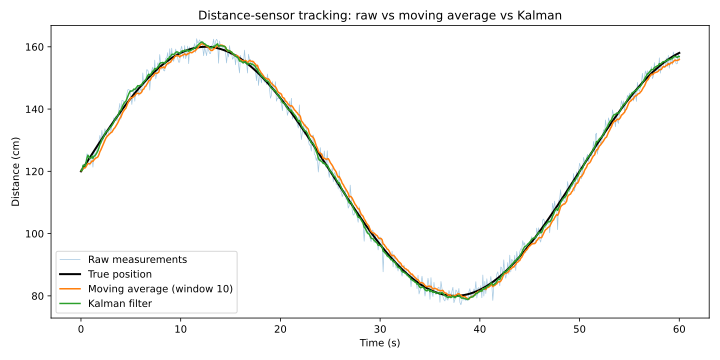
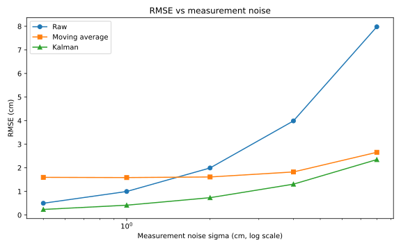

# Kalman Sensor DSP

Follow-up to [Embedded-Sensor-DSP-Simulation](https://github.com/UnknownSlayer1/Embedded-Sensor-DSP-Simulation).
That project showed a moving average cutting RMSE from 2.00 to 0.60 cm on
synthetic sensor data. This project asks the follow-up question: what
happens when the target actually moves? Answer: the moving average's lag
eats most of the gain, and a Kalman filter wins by a wide margin.

## Scenario

An optical distance sensor tracks a target moving smoothly in front of it,
sampled at 10 Hz for 60 seconds:

- True position: `120 + 40 * sin(2 * pi * 0.02 * t)` cm (peak speed ~5 cm/s)
- Measurements: true position plus zero-mean Gaussian noise
- Default noise level: sigma = 2.0 cm, the same level as the MATLAB sim

## Filters compared

- **Raw measurements**, no filtering
- **Moving average**, window of 10 samples (1 second)
- **Kalman filter**, constant-velocity model: state is `[position, velocity]`,
  only position is measured, process noise follows the discrete white-noise
  acceleration (DWNA) model with spectral density `q = 5.0`, tuned on this
  scenario (the RMSE curve is flat for `q` in 5-8, so this is not a
  knife-edge value). The filter is initialized from the first measurement.

## Results

Main run, sigma = 2.0 cm:

| Filter | RMSE (cm) |
| --- | --- |
| Raw | 1.995 |
| Moving average | 1.613 |
| Kalman | 0.735 |

The Kalman filter lands 63% below raw and 54% below the moving average.



Noise sweep (same seed, same trajectory):

| sigma (cm) | Raw | Moving average | Kalman |
| --- | --- | --- | --- |
| 0.5 | 0.499 | 1.596 | 0.236 |
| 1.0 | 0.997 | 1.587 | 0.416 |
| 2.0 | 1.995 | 1.613 | 0.735 |
| 4.0 | 3.989 | 1.825 | 1.308 |
| 8.0 | 7.979 | 2.658 | 2.349 |



## The interesting finding

The moving average has a **lag floor** of about 1.6 cm on this trajectory:
at low noise (sigma = 0.5 and 1.0 cm) it is *worse than doing nothing*,
because the target moves while the window averages. A 10-sample window
lags roughly half a second behind a target moving up to 5 cm/s, and no
amount of noise reduction pays that back. The Kalman filter carries a
velocity state, so it tracks the motion instead of lagging it, and it wins
at every noise level tested.

## Honest limitations

- Simulated data only; no real sensor hardware yet
- One trajectory shape, one seed for the headline numbers
- `q` was tuned on this scenario, not on held-out data
- Next steps: log real data from a microcontroller plus ranging sensor,
  try adaptive `q`, and compare against a median filter and an alpha-beta
  filter

## Run it

```bash
pip install -r requirements.txt
python run_comparison.py
python -m pytest tests/
```

`run_comparison.py` prints the tables above and regenerates the figures.

## Structure

- `sensor_dsp/simulation.py` — trajectory and noisy measurements
- `sensor_dsp/filters.py` — moving average and constant-velocity Kalman filter
- `sensor_dsp/metrics.py` — RMSE
- `run_comparison.py` — main run plus noise sweep, writes `figures/`
- `tests/test_filters.py` — filter sanity tests
